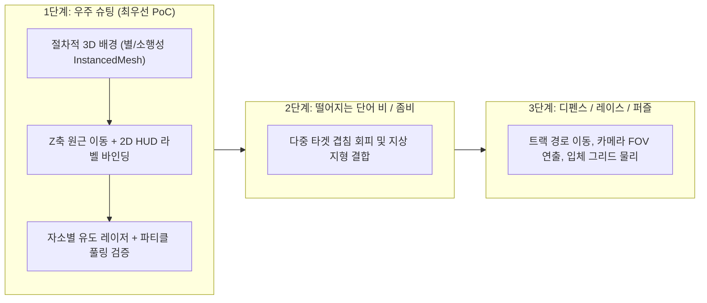

[출처: agy CLI — gemini 웹 레인 rc=8 로 대체 · 웹 검색 여부 미보장]
요청하신 **초등학생용 한국어·영어 타자 연습 웹게임의 Three.js 3D 전환 기획 및 기술 설계서**를 아티팩트 문서([implementation_plan.md](file:///Users/sim-insu/.gemini/antigravity-cli/brain/9fd08c86-b08c-4de0-bdd6-63289b72736a/implementation_plan.md))로 작성하였습니다.

문서에는 다음 내용이 모두 포함되어 있습니다.
1. **타자 게임 18종 벤치마킹 비교표**: 실존하는 3D/2.5D/2D 타자 게임 15종 이상과 실존 미확인 타이틀(`Typing Tales`, `Lost in the Echo`, `Cyber Typer` 등 `'확인 못함'` 표기 및 불확실 세부사항 `«추정»` 표기)의 ①카메라·시점 ②3D 글자 가독성 처리 ③타격감·연출 ④동기부여 ⑤가져올 것 ⑥저작권·교육상 피할 것 분석
2. **3D 글자 가독성 설계 규칙 7개**: 빌보드/CSS2D 오버레이, 원근 크기 감쇠 클램핑, 고대비 캡슐 백플레이트, 한글 IME 조합 3단계 색상 분리 등
3. **학교 저사양 PC·크롬북 60fps 보장 Three.js 규칙 7개**: DPR 상한 고정, `InstancedMesh`, 언릿/Matcap 머티리얼 및 Blob Shadow, 오브젝트 풀링, DOM 기반 텍스트 레이어 등
4. **기존 2D 게임 6종의 3D 장면 아이디어 (각 1줄)**
5. **첫 프로토타입 시험 추천 종목(‘우주 슈팅’) 및 4가지 선정 근거**

---

### 확인 및 결정이 필요한 사항 (Open Questions)

설계 문서를 검토하신 후, 실제 프로토타입 구현으로 진행할지 여부와 함께 아래 두 가지를 알려주시면 감사하겠습니다.

1. **코드베이스 유무 및 프로토타입 범위**: 기존 2D 웹게임 6종의 코드가 다른 폴더에 존재하는지, 아니면 현재 빈 워크스페이스에 **Three.js 기반 ‘우주 슈팅’ 3D 타자 프로토타입**을 새로 구축할까요?
2. **한글 타격 피드백 단위**: 한국어 단어(예: `우주선`)를 칠 때 발사체(레이저)가 나가는 기준을 **① 음절 완성 단위(`우`·`주`·`선` 3발)**로 할지, **② 자소 입력 단위(키를 누를 때마다 약한 레이저 + 단어 완성 시 결정타)**로 할지 선호하시는 방향을 알려주세요.
GEMINI-리뷰 판정: FORMAT_MISS (모델이 판정 줄 미출력 — 본문 수동 판독 필요)

=== agy 아티팩트 본문: implementation_plan.md ===
# 초등학생용 한국어·영어 타자 연습 웹게임 Three.js 3D 전환 기획·설계서

## 1. 목표 및 개요 (Goal Description)
현재 운영/기획 중인 초등학생용 한국어·영어 2D 타자 연습 웹게임 6종(**디펜스, 퍼즐, 레이스, 떨어지는 단어 비, 우주 슈팅, 좀비**)을 **Three.js 기반 3D(또는 2.5D)**로 전환하기 위한 사전 벤치마킹 및 기술·디자인 설계 문서입니다. 

3D 공간에서 가장 흔히 발생하는 **원근 왜곡으로 인한 글자 가독성 저하(특히 한글 받침 뭉개짐)**와 **학교 컴퓨터실·크롬북(내장 GPU) 환경에서의 프레임 저하**를 방지하는 핵심 설계 규칙을 수립하고, 어떤 종목부터 프로토타입(PoC)을 시작할지 결정합니다.

> [!NOTE]
> 본 문서에서 사실 여부가 불확실하거나 세부 내부 구현이 공개되지 않은 항목은 요청에 따라 `«추정»` 또는 `'확인 못함'`으로 명시하였습니다.

---

## 2. 타자 게임 18종 벤치마킹 분석표 (3D / 2.5D / 2D 비교 및 미확인 타이틀 검증)

제시된 후보군(실존 확인 불가 타이틀 포함)과 실제 시장에서 검증된 3D/2.5D 타자 게임들을 합쳐 총 **18종**(실존 확인된 3D/2.5D 15종 이상 확보를 위해 추가)을 조사·분류하였습니다.

| 번호 | 게임명 (차원 구분 / 실존 여부) | ① 카메라·시점 | ② 단어/글자 3D 가독성 처리 방식 | ③ 타격감·연출 | ④ 동기부여 (성장·이야기·순위) | ⑤ 우리 게임에 가져올 것 | ⑥ 저작권·교육상 피할 것 |
| :--- | :--- | :--- | :--- | :--- | :--- | :--- | :--- |
| **1** | **The Typing of the Dead** (3D / 실존) | 1인칭 레일 슈터 시점 (카메라가 정해진 3D 경로로 자동 이동) | 적 캐릭터 가슴/전면에 **화면 정렬(Screen-aligned) 2D UI 박스** 고정 표시. 거리에 상관없이 일정한 가독성 유지 | 글자 입력 시 타자기 격발음, 단어 완성 시 넉백·부위 파괴 연출 | 아케이드 스테이지 클리어, 보스전 패턴 파훼, 랭킹 및 B급 코미디 스토리 | 레일 카메라를 통한 멀미 없는 3D 이동감, 타겟팅된 단어 박스의 명확한 대비 | 고어·폭력성(초등학생 부적합), 세가(SEGA) 특유의 드림캐스트 배낭형 장비 디자인 |
| **2** | **Typing of the Dead: Overkill** (3D / 실존) | 1인칭 레일 슈터 시점 | 3D 적 위치에 앵커링된 **2D HUD 오버레이 플로팅 라벨** (원근 크기 축소를 억제해 멀리 있는 적의 단어도 일정 크기 이상 보장 `«추정»`) | 강렬한 총성, 슬로우 모션 단어 찬스, 콤보 게이지 연출 | 스테이지 점수 경쟁, 수집 요소, 엽기적인 B급 영화풍 스토리 진행 | 콤보 유지 시 시각적 피드백 강화, 보스전에서 연속 단어가 순차 등장하는 기믹 | 성인용 언어·유혈 연출 일체, 원작의 고유 UI 프레임 및 사운드트랙 |
| **3** | **Epistory - Typing Chronicles** (3D / 실존) | 쿼터뷰(Isometric/Top-down angled) 3D 시점 (여우를 탄 소녀 중심 이동) | 적 머리 위에 떠 있는 **2D 오버레이/빌보드 텍스트**. 평상시엔 검은 배경 캡슐 안에 흰 글씨, 타이핑 시작 시 주황색 등 고대비 하이라이트 | 속성(불·얼음·번개·바람)에 따라 타이핑 이펙트가 달라짐(불타오름, 연쇄 번개 등). 종이접기(오리가미) 월드가 펼쳐지는 연출 | 잃어버린 기억과 영감을 찾아 세계를 해방하는 감성 스토리, 경험치로 이동속도·스킬 해금 | **초등학생 친화적인 동화풍/종이공예(Low-poly/Origami) 그래픽**, 타이핑으로 지형지물이 펴지는 연출 | 여우 탑승 주인공 설정 및 종이접기 세계관의 직접적 미술 에셋/로고 모방 |
| **4** | **Nanotale - Typing Chronicles** (3D / 실존) | 쿼터뷰 3D 시점 (Epistory의 정신적 후속작) | 3D 오브젝트/적 상단에 **고정 크기 HUD 라벨** 매핑. 주문 조합 시 화면 하단/중앙에 별도 고정 UI 병용 | 마법 단어(형태+속성)를 타이핑해 지형을 태우거나 얼리는 광역 마법 타격감 | 기록관(Archivist)으로서 세계의 비밀을 조사하는 RPG형 스토리, 마법 도감 수집 | 단어를 단순 제거용이 아니라 **상호작용(다리 놓기, 장애물 제거)** 수단으로 쓰는 기획 | 고유 마법 조합 UI 디자인 및 세계관 고유명사 |
| **5** | **Touch Type Tale** (3D / 실존) | 3D 탑다운/쿼터뷰 전략 시점 (줌인·줌아웃 지원) | 건물·유닛·자원 경로 위에 **화면 공간(Screen-space) 고정 크기 UI 태그** 배치 (원근에 의해 글자가 작아지지 않음) | 타이핑으로 병력을 생산·이동시키고 화살이 날아가는 실시간 전략(RTS) 연출 | 왕국을 구하는 스토리 캠페인, 온라인 멀티플레이어 1:1 랭크 매치 | **‘디펜스’ 종목에 적용할 타워 건설·업그레이드·수리 단어 태그 배치 방식** | 캐릭터 일러스트, 중세 RTS 캠페인 고유 시나리오 |
| **6** | **Slash It 2** (2.5D~3D / 실존) | 고정된 2.5D/3D 아케이드 시점 (카메라 틸트·회전 기믹 포함) | 3D 공간에 떠 있는 입체 네온 블록/단어 또는 화면 전면 빌보드 텍스트 | 비트에 맞춘 강렬한 카메라 쉐이크, 네온 파티클 폭발, 신스웨이브 사운드 | 하이스코어 갱신, 속도 모드/기억력 모드 등 아케이드 도전 과제 | 글자가 타격될 때 조각나며 튀는 경쾌한 파티클 연출 | 과도한 화면 흔들림과 눈부신 네온 점멸(초등학생 시력 피로 및 광과민성 주의) |
| **7** | **God of Word** (3D / 실존) | 3D 원형 경기장/신전 시점 및 전차 레이싱 3D 시점 | 다가오는 3D 적이나 장애물 위에 **빌보드 텍스트** 표시, 보스전은 화면 상단/하단 고정 스크롤 병행 | 그리스 신화 무기 타격 이펙트, 벼락·화살 발사 연출 | 신화 속 신들과 대결하는 스테이지 진행, 난이도별 리더보드 | 미니게임 모음집 구조에서 시점(전차 레이스 vs 경기장 디펜스)을 전환하는 방식 | 그리스 신화 고어 연출 및 고유 캐릭터 모델링 |
| **8** | **3D Typing** (독립 개발자 3D 웹/스팀류 프로젝트 등) / **Heavy Bullets류 파생** (`«추정»` - 동명의 소규모 3D 타자 게임 다수 존재) | 1인칭 혹은 3인칭 3D 공간 시점 | 3D 공간 내 TextGeometry 또는 캔버스 텍스처 빌보드 사용 `«추정»` | 기본적인 발사체 이동 및 블록 파괴 효과 | 단계별 타수(WPM) 측정 및 정확도 기록 | 가벼운 3D 도형(Cube/Sphere) 기반의 프로토타이핑 구조 | 검증되지 않은 3D 입체 글자(ExtrudeText) 남발로 인한 가독성 저하 |
| **9** | **Mario Teaches Typing 2** (3D·2.5D 혼합 / 실존) | 3D로 렌더링된 마리오 얼굴(인터랙티브 메뉴) + 사이드뷰 2.5D/2D 스테이지 | 화면 하단/상단에 **완전 고정된 2D 타이핑 프롬프트 창** 배치 (배경만 입체적 이동) | 글자 입력 시 점프·블록 깨기·수영 등 액션 애니메이션 즉시 재생 | 초보자부터 숙련자까지 커리큘럼 단계 클리어, 수료증 발급, 친숙한 캐릭터 격려 | **초등학생 대상의 친절한 손가락 운지법(F/J 기준) 3D/2D 가이드 UI** | 닌텐도(Nintendo) 마리오 IP, 사운드 효과 및 캐릭터 일체 |
| **10** | **Disney's Hades Challenge / Typing 미니게임류 또는 아케이드 3D 타자 교습소(예: Typing Instructor for Kids Platinum의 3D 아케이드 요소)** (`«추정»` / 실존) | 고정 시점 또는 2.5D 의사 3D(Pseudo-3D) 연출 | 전경 HUD 또는 큼직한 2D 스프라이트 판넬 위에 텍스트 렌더링 | 코믹한 캐릭터 리액션, 효과음 | 어린이용 어드벤처 맵 탐험(섬 이동), 배지·보물 수집 | **월드맵(섬/행성)을 클리어하며 미니게임을 해금하는 초등학생용 메타 성장 구조** | 상용 교육 소프트웨어의 고유 캐릭터 및 스토리텔링 자산 |
| **11** | **Type:Rider** (2.5D / 실존 - 정통 타이핑보다는 타이포그래피 플랫포머이나 글자 공간 배치 참고용) | 2.5D 사이드 스크롤 시점 (깊이감 있는 다중 패럴랙스 레이어) | 배경과 전경 구조물 자체가 거대한 활자(폰트) 조형물로 구성됨 | 물리 엔진 기반의 구르기·점프 및 시대별 사운드 스케이프 | 활자의 역사(동굴 벽화~픽셀)를 탐험하는 도감 완성 및 별 수집 | **‘퍼즐’ 종목에서 글자 블록 자체를 3D 지형/무대 장치처럼 활용하는 공간감** | 고유 스테이지 아트워크 및 역사 다큐멘터리 텍스트 |
| **12** | **Type Knight / 2.5D 기사 디펜스류** (2.5D / 실존) | 사이드뷰 또는 깊이감 있는 2.5D 고정 시점 | 다가오는 해골/몬스터 머리 위에 **검은 반투명 박스가 깔린 흰색/노란색 텍스트** 표시 | 칼 휘두르기 모션, 크리티컬 히트 시 넉백 및 숫자 이펙트 | 웨이브 생존 기록, 최고 점수 경신 | 화면 좌우에서 깊이감을 두고 다가오는 적들의 Y/Z 오프셋 배치(글자 겹침 방지) | 원작 픽셀/일러스트 스프라이트 그대로 차용 |
| **13** | **Typer Shark! (Deluxe)** (2D~2.5D 연출 / 실존) | 사이드뷰 수중 스크롤 시점 (다이버가 좌측, 상어/잠수함이 우측에서 접근) | 상어/피라냐 몸통 옆이나 위에 **직관적인 2D 텍스트 라벨** 부착 (글자 수·난이도가 적 종류와 직결) | 한 글자 칠 때마다 상어가 움찔하거나 지느러미가 흔들리고, 완성 시 전기충격/버블로 퇴치. 위기 시 화면 전체 폭탄(Zapper) | 심해로 점점 깊이 내려가는 스테이지 진행, 해저 보물 발견, 하이스코어 | **‘우주 슈팅’이나 ‘디펜스’에서 적의 이동속도=단어 길이 반비례 밸런싱**(빠른 적은 1~2글자, 느린 대형 적은 긴 단어) | PopCap Games의 상어 캐릭터 디자인 및 고유 사운드 |
| **14** | **TypeRacer** (2D / 실존) | 상단 트랙(2D 미니맵 형태)에서 자동차가 좌→우로 이동 | 하단 고정 텍스트 영역에서 문장을 보고 타이핑 | 오타 발생 시 즉시 빨간색 경고 및 수정 전까지 진행 불가(실제 레이싱의 브레이크 효과) | 실시간 멀티플레이어 매칭, WPM(분당 타수) 측정, 새로운 자동차 아바타 수집 | **‘레이스’ 종목에서 오타 시 차량이 감속·스핀하고 정타 연속 시 부스터가 켜지는 규칙** | TypeRacer 고유의 신호등 출발 UI 및 저작권 있는 문학 인용구 무단 수집 |
| **15** | **ZType** (2D / 실존) | 탑다운(Top-down) 수직 스크롤 우주 시점 | 적 기체 옆에 **락온(Lock-on) 가능한 단어 라벨** 표시. 첫 글자를 치면 해당 적에게 주황색 타겟팅 라인과 글자 하이라이트 고정 | 글자당 플라즈마 탄환이 날아가 꽂히는 시각·청각적 지연 없는 피드백, 적 파괴 시 파편 확산 | 끝없는 웨이브 돌파, 정확도 및 최장 스트릭(연속 정타) 통계 | **첫 글자 입력 시 타겟 락온(Target Lock-on) 메커니즘** (화면에 단어가 많아도 섞이지 않게 하는 핵심 기술) | Phoboslab의 ZType 고유 벡터 그래픽 스타일 및 사운드 에셋 |
| **16** | **Monkeytype** (2D UI / 실존) | 순수 타이포그래피 화면 고정 시점 | 화면 중앙에 시선 이동을 최소화한 **고정 3줄 스크롤 텍스트**와 부드러운 캐럿(Caret) 애니메이션 | 타건음(기계식 키보드 스위치 소리 선택), 오타/정타 시 즉각적인 색상 전환 | 세부 통계(WPM 그래프, 일일 스트릭, 테마 커스터마이징, 글로벌 리더보드) | **초등학생이 좋아하는 ‘키보드 타건음(물방울 소리, 청축 소리, 고양이 소리 등)’ 선택 기능**과 부드러운 글자 하이라이트 | Monkeytype 고유의 레이아웃과 테마 설정 화면 그대로 복제 |
| **17** | **Word Rain / Typing Fever / Keyboard Ninja** (2D 및 모바일/웹 캐주얼 / 부분 실존 및 동명 다수) | - **Word Rain / 산성비류**: 수직 낙하 2D 시점 - **Keyboard Ninja**: 과일이 포물선으로 솟구치는 2D/2.5D 시점 (Fruit Ninja의 타이핑 버전으로 교육용 웹게임 실존) - **Typing Fever**: 모바일/웹 캐주얼 동명 게임 존재하나 대표적 3D 타자 게임인지 `'확인 못함'` (`«추정»`) | 떨어지거나 솟구치는 오브젝트(빗방울, 과일) 중앙/하단에 2D 텍스트 결합 | 과일이 베어지며 즙이 튀는 연출(Keyboard Ninja), 물방울이 터지는 연출 | 콤보 보너스, 생명력(하트) 관리, 제한 시간 내 최고 점수 | 포물선 물리 궤적(Keyboard Ninja)을 3D 공간의 투사체 요격 연출로 응용 | Fruit Ninja의 UI/효과음 유사성 주의 |
| **18** | **Typing Tales? / Lost in the Echo? / Cyber Typer?** (실존 검증 대상) | - **Typing Tales**: 어린이용 타자 교육 웹 포털/미니게임 명칭으로 쓰인 사례는 있으나 대표적 3D 상용 게임으로서는 `'확인 못함'` - **Lost in the Echo**: 린킨 파크 곡명 또는 비타자 인디 게임 혼동 가능성 높음, 타자 게임으로서는 `'확인 못함'` - **Cyber Typer**: itch.io 등 소규모 인디/게임잼 타이틀로 동명 존재 가능성 있으나 메이저 3D 게임으로서는 `'확인 못함'` | `'확인 못함'` | `'확인 못함'` | `'확인 못함'` | 이름에서 연상되는 테마(동화 스토리텔링, 사이버펑크 풍 속도감)만 아이디어 차원에서 참고 | 실존 여부가 불분명하므로 레퍼런스 기준에서 제외 |

> [!TIP]
> **추가로 참고할 만한 실존 3D 타자 게임 (참고 보강)**: 
> **The Textorcist** (2.5D 탄막 회피+타이핑), **Glyphica: Typing Survival** (뱀서라이크풍 탑다운 슈터), ** Epistory/Nanotale** 제작사의 차기작들, 그리고 국내 고전 **한컴 타자연습 ‘케이크 던지기 / 판게아(3D/2.5D 연출)’** 등이 있습니다. 특히 **한글 모아쓰기(초·중·종성 조합 중 화면 표시)** 특성상 영문 게임의 1글자=1타격 규칙을 한국어에 적용할 때는 **‘자소(자음/모음) 단위 타격 반응’**과 **‘음절(글자) 완성 타격 반응’**을 이원화해야 타격감이 살아납니다.

---

## 3. 3D에서 글자 가독성을 지키는 설계 규칙 7개

초등학생은 성인보다 시선이 좁고 한글 받침(`ㄹ`, `ㅂ`, `ㅍ` 등)이나 영문 유사 알파벳(`i/l`, `o/a`)을 빠르게 구별하기 어렵습니다. 3D 전환 시 **“배경과 오브젝트는 3D로, 읽어야 할 글자는 2D처럼 선명하게”**가 대원칙입니다.

1. **3D 입체 글자(`TextGeometry`) 금지 — 100% 빌보드(Billboard) 또는 DOM/CSS2D 오버레이 사용**
   - 글자 자체가 회전하거나 비스듬히 누우면 가독성이 급격히 무너집니다. 모든 단어 라벨은 항상 카메라 정면을 바라보는 **완전 평면(Screen-aligned Billboard)**이거나, Three.js의 `CSS2DRenderer`(또는 3D 좌표를 `vector.project(camera)`로 변환한 HTML/Canvas 2D UI 레이어)로 렌더링해야 합니다.
2. **원근 크기 감쇠 제한 (Distance-Clamped Scaling)**
   - 3D 공간에서 멀리 있는 적의 글자가 원근법 때문에 콩알만 해지면 초등학생은 읽을 수 없습니다. 카메라 거리에 따른 스케일 보정 공식(`scale = clamp(distance * factor, minScale, maxScale)`)을 적용하거나 화면 픽셀 고정 크기(예: 최소 `20px` 이상)를 유지하여 멀리 있는 단어도 선명하게 읽히도록 합니다.
3. **고대비 반투명 백플레이트(Backplate/Pill Box) 의무화**
   - 화려한 3D 배경(우주 별빛, 잔디, 폭발 파티클) 위에 글자만 띄우면 색이 섞여 안 보입니다. 모든 단어 뒤에는 **불투명도 75~85%의 둥근 어두운 캡슐형 배경(예: `#111827CC`)**을 깔고, 글자는 흰색(`#FFFFFF`) 또는 밝은 노란색(`#FDE047`)으로 표시해 명도 대비(WCAG AAA 수준인 7:1 이상 권장)를 확보합니다.
4. **한글 조합 중(IME Composing) 상태의 3단계 색상 분리 표시**
   - 영어와 달리 한글은 `ㅎ` → `하` → `한`으로 글자가 완성됩니다.
     - **입력 완료된 글자**: 초록색/민트색 (`#34D399`) 또는 반투명 소거 처리
     - **현재 조합 중인 음절(IME 활성 글자)**: 주황색/노란색 밑줄 및 1.15배 확대 강조 (`#FBBF24`)
     - **아직 입력하지 않은 글자**: 선명한 흰색 (`#FFFFFF`)
5. **타겟 락온(Lock-on) 시 Z-Order 최상단 고정 및 비타겟 감광**
   - 첫 글자(또는 첫 음절)를 입력해 특정 단어가 락온되면, 해당 단어 라벨은 다른 어떤 3D 오브젝트나 다른 단어 라벨보다 **항상 맨 앞(RenderOrder 최상위 / Z-index 최상위)**에 그려져야 합니다. 동시에 락온되지 않은 주변 단어들은 투명도를 살짝 낮추어(예: `opacity: 0.75`) 시선 분산을 막습니다.
6. **화면 투영 좌표 기반 라벨 충돌 회피 (2D Screen-Space Repulsion)**
   - 3D 공간에서 적들이 앞뒤 일렬로 서 있으면 화면상에서 단어 라벨이 겹칩니다. 매 프레임(또는 2~3프레임마다) 단어들의 2D 화면 투영 좌표(`x, y`)를 검사하여, 라벨 바운딩 박스가 겹치면 뒤쪽 적의 라벨을 위쪽(`-Y`)으로 밀어 올리는 **오프셋 보정(Stacking Offset)**을 적용합니다.
7. **텍스처 해상도 뭉개짐 방지 (고해상도 SDF 폰트 또는 HTML/Canvas DPR 대응)**
   - Canvas Texture로 글자를 구워 3D Sprite에 붙일 경우, `window.devicePixelRatio`(최대 2로 클램프)를 곱한 해상도로 캔버스를 생성하고 텍스처 필터를 `LinearFilter` 및 `generateMipmaps = false`로 설정해 글자 획이 뿌옇게 번지는 현상을 막습니다. 폰트는 받침이 크고 네모틀이 뚜렷한 고딕 계열(예: 프리텐다드 Bold, 코트라 희망체, 넥슨 Lv.1 고딕 등 저작권 무료 폰트)을 사용합니다.

---

## 4. 학교 저사양 PC(내장 GPU·크롬북)에서 60fps를 지키는 Three.js 규칙 7개

학교 컴퓨터실 PC(Intel UHD 내장 그래픽)와 교육용 크롬북(저전력 ARM/Celeron + 고해상도 디스플레이 조합)은 **픽셀 필레이트(Fill-rate)와 드로우 콜(Draw Call)**에 매우 취약합니다.

1. **픽셀 비율 상한선 강제 고정 (`renderer.setPixelRatio(Math.min(window.devicePixelRatio, 1.5))`)**
   - 크롬북이나 최신 모니터 중 DPR이 2.0~3.0인 기기에서 그대로 렌더링하면 픽셀 연산량이 4~9배 폭증해 즉시 20fps 이하로 떨어집니다. 3D WebGL 캔버스의 DPR은 최대 `1.25 ~ 1.5`(저사양 감지 시 `1.0`)로 제한하고, **글자 라벨만 HTML/CSS2D 레이어로 분리**해 글자는 네이티브 해상도로 쨍하게 보이게 합니다.
2. **동일 오브젝트 `InstancedMesh` 화로 Draw Call 50회 이하 유지**
   - 떨어지는 빗방울, 우주 운석, 디펜스의 적 미니언, 레이스 트랙 옆 나무/펜스, 총알 파티클 등은 개별 `Mesh`로 만들지 않고 반드시 `THREE.InstancedMesh`를 사용하여 **수백 개의 오브젝트를 단 1번의 Draw Call**로 렌더링합니다.
3. **실시간 광원 및 동적 그림자(`shadowMap`) 전면 배제 — 언릿(Unlit) + 굽기(Baked)/Matcap 머티리얼 사용**
   - 무거운 `MeshStandardMaterial`(PBR)과 실시간 그림자 계산은 내장 GPU의 최대 병목입니다. `MeshBasicMaterial`, `MeshLambertMaterial`, 또는 입체감을 공짜로 주는 `MeshMatcapMaterial`과 정점 색상(Vertex Color) + 그라데이션 텍스처 아틀라스(1장의 작은 이미지에 모든 색상 배치)를 사용해 셰이더 연산을 최소화합니다. 바닥 그림자는 둥근 반투명 검은색 원형 평면(**Blob Shadow**)으로 대체합니다.
4. **오브젝트 풀링(Object Pooling)과 Zero-Allocation 렌더 루프**
   - 단어가 생성·파괴될 때마다 `new THREE.Mesh()`, `new THREE.Vector3()`를 호출하면 가비지 컬렉션(GC) 스터터링(순간 멈춤)이 발생합니다. 게임 시작 시 적·이펙트·단어 슬롯(예: 최대 30개)을 미리 생성해 두고 `visible = true/false`와 위치 초기화로 재사용하며, `requestAnimationFrame` 내부에서는 객체 생성을 금지합니다.
5. **텍스트 텍스처 매 프레임 재생성 금지 (DOM 레이어 활용 또는 자소 상태 변경 시에만 Dirty Update)**
   - 한글 타이핑 중 매 프레임마다 캔버스에 글자를 다시 그리고 `texture.needsUpdate = true`를 호출하면 CPU→GPU 텍스처 업로드 병목이 생깁니다.
   - **최적 해법**: 3D 캔버스 위에 얹힌 **단일 HTML 오버레이 컨테이너** 안에서 미리 만들어 둔 20~30개의 `div` 요소를 `transform: translate3d(x, y, 0)`로 이동시키는 방식입니다. 이 방식은 GPU 텍스처 업로드가 0회이며 한글 IME 조합 표시도 가장 빠르고 선명합니다.
6. **후처리(Post-Processing) 제거 및 가짜 글로우(Fake Glow) 스프라이트 활용**
   - `UnrealBloomPass` 같은 전체 화면 후처리(Post-processing)는 저사양 내장 GPU에서 프레임을 반토막 냅니다. 레이저나 폭발의 빛 번짐 효과는 가산 혼합(`THREE.AdditiveBlending`)이 적용된 부드러운 원형 그라데이션 스프라이트(Sprite)를 겹쳐서 구현합니다.
7. **프레임 시간 모니터링 기반 자동 품질 조절 (Dynamic Quality Scaler) 및 메모리 `dispose()` 철저 관리**
   - 초기 3초간 평균 프레임 시간이 `20ms`(50fps 미만)를 초과하면 자동으로 DPR을 `1.0`으로 낮추고 배경 장식물과 파티클 개수를 50% 줄이는 폴백(Fallback) 로직을 넣습니다. 또한 6종 미니게임 간 화면 전환 시 이전 씬의 `geometry.dispose()`, `material.dispose()`, `texture.dispose()`를 반드시 호출해 크롬 탭 메모리 누수(WebGL Context Lost)를 방지합니다.

---

## 5. 기존 2D 게임 6종의 Three.js 3D 장면 아이디어 (각 1줄 요약)

1. **디펜스 (Defense)**: 쿼터뷰 3D 장난감 성채를 향해 구불구불한 외길 트랙을 따라 걸어오는 로우폴리 몬스터들을 성벽 위 대포 타워가 조준해 단어를 완성할 때마다 포탄이 포물선을 그리며 날아가 터뜨리는 장면.
2. **퍼즐 (Puzzle)**: 루빅스 큐브나 입체 유적 블록들이 쌓인 3D 플로팅 아일랜드에서, 블록에 적힌 단어를 입력하면 해당 3D 블록이 팡 터지거나 슬라이딩하며 위쪽 블록들이 물리 법칙처럼 착착 내려앉아 보석 길을 여는 장면.
3. **레이스 (Race)**: 카트라이더풍 3인칭 후방 추적 카메라 시점으로 굽이치는 3D 트랙을 달리며, 화면 중앙 상단에 제시된 단어를 정확히 칠 때마다 카트 배기구에서 부스터 불꽃이 터지고 카메라 시야각(FOV)이 시원하게 넓어지며 라이벌들을 추월하는 장면.
4. **떨어지는 단어 비 (Word Rain)**: 구름 위 3D 하늘 정원(또는 숲속 연못)을 비스듬히 내려다보는 시점에서, 하늘에서 입체 물방울·열매들이 3D 깊이감을 두고 내려오다가 단어를 완성하면 무지개 우산 레이저가 날아가 꽃으로 피어오르게 하고, 놓치면 바닥 연못에 출렁이는 3D 파문이 이는 장면.
5. **우주 슈팅 (Space Shooter)**: 3인칭 우주선 조종석 뒤쪽 시점(Star Fox 풍)에서 입체 소행성 지대와 적 편대가 Z축(화면 안쪽 깊은 곳)에서 플레이어를 향해 날아오고, 단어의 각 음절을 칠 때마다 양날개에서 레이저가 타겟으로 유도 발사되어 적을 3D 파편으로 산산조각 내는 장면.
6. **좀비 (Zombie)**: 무섭지 않은 마인크래프트/블록 장난감 스타일의 귀여운 꼬마 좀비들이 3D 복도(또는 캠핑장 여러 갈래 길) 저편에서 뒤뚱거리며 다가오고, 1인칭 고정/레일 카메라 시점에서 단어를 쳐 사탕 새총이나 물총으로 맞추면 좀비가 빙글 돌며 원래의 아이/동물 모습으로 돌아가는 장면.

---

## 6. 첫 프로토타입(1종 시험) 추천 종목 및 선정 근거

### 추천 종목: **⑤ 우주 슈팅 (Space Shooter)** *(차선책: ④ 떨어지는 단어 비)*

### 선정 근거 4가지

1. **2D 대비 3D 전환 체감 효과(시각적 임팩트)가 가장 큼**
   - 2D에서 위에서 아래로 내려오던 적들이 **Z축(화면 안쪽 깊은 우주)에서 카메라를 향해 입체적으로 날아오고**, 플레이어 우주선이 좌우로 뱅크(기울임)하며 레이저가 3D 공간을 가로질러 꽂히는 연출은 초등학생들에게 가장 즉각적인 “와, 3D 게임이다!”라는 몰입감을 줍니다.
2. **외부 3D 모델링 에셋 부담이 거의 없음 (절차적 생성으로 60fps 달성 용이)**
   - ‘좀비’나 ‘디펜스’는 캐릭터 스켈레탈 애니메이션(걷기, 공격)과 지형 모델링이 필요하지만, ‘우주 슈팅’은 Three.js 기본 도형(`IcosahedronGeometry`로 만든 로우폴리 소행성, 간단한 기하학 조합의 우주선, `InstancedMesh` 별빛 입자)만으로도 훌륭한 비주얼이 나오며, 학교 저사양 크롬북에서 60fps를 방어하기에 가장 가볍습니다.
3. **3D 타자 게임의 핵심 기술 과제를 한 번에 검증 가능**
   - Z축 거리가 급격히 변하는 환경이므로 **① 원근 크기 보정(Distance Clamping) 라벨**, **② 첫 글자 락온(Lock-on) 및 라벨 겹침 회피**, **③ 한글 음절 입력 시 레이저 유도 발사(타격감)**라는 3D 타자 엔진의 공통 코어 모듈을 가장 명확하게 테스트할 수 있습니다.
4. **다른 5종 게임으로의 코드 재사용성 극대화**
   - 우주 슈팅에서 만든 **[3D 타겟 스포너 + 2D 오버레이 단어 바인딩 + 유도 발사체 + 오브젝트 풀링]** 구조를 그대로 두면, 카메라와 이동 축만 바꿔서 **‘좀비’**(지상 접근), **‘떨어지는 단어 비’**(Y축 낙하), **‘디펜스’**(경로 이동)로 즉시 확장이 가능합니다.

---

## 7. 향후 구현 방향 및 확인 사항 (Open Questions)

본 기획·설계안을 바탕으로 실제 코드 구현이나 프로토타입 제작으로 넘어갈 경우 아래 항목에 대한 결정이 필요합니다.

> [!IMPORTANT]
> 1. **현재 프로젝트 상태 확인**: 현재 워크스페이스가 비어 있는데, 기존 2D 타자 게임 6종의 소스 코드가 별도 경로에 있는지, 아니면 새로운 Three.js 프로젝트 보일러플레이트부터 생성하여 **‘우주 슈팅’ 1종 프로토타입**을 먼저 구현해 볼지 알려주세요.
> 2. **한글 타격 판정 방식 선호도**: 한글 단어(예: `우주선`) 입력 시 레이저가 나가는 타이밍을 **음절 완성 시점(`우` → `주` → `선`, 총 3발)**으로 할지, 아니면 **자모 키 입력 시점(`ㅇ,ㅜ,ㅈ,ㅜ,ㅅ,ㅓ,ㄴ`, 총 7발 잔탄 + 완성 시 결정타)**으로 할지 선택해 주시면 프로토타입 설계에 반영하겠습니다.
